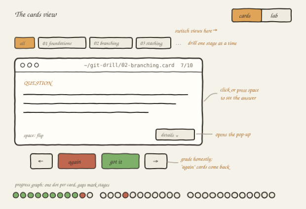
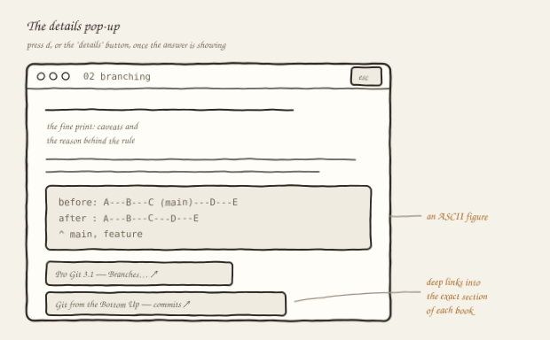
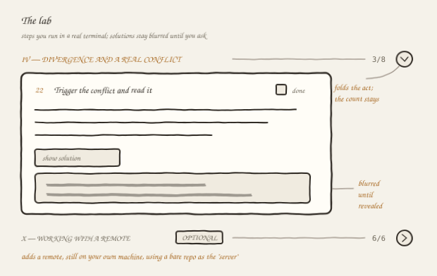
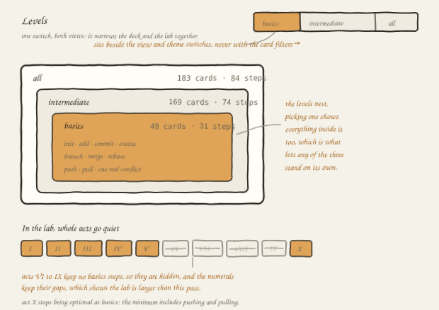
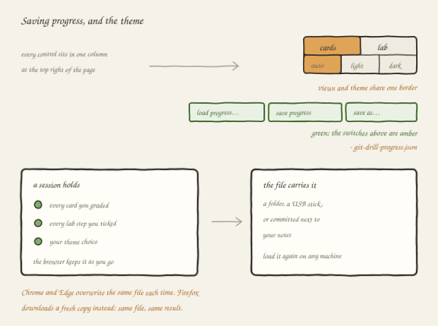
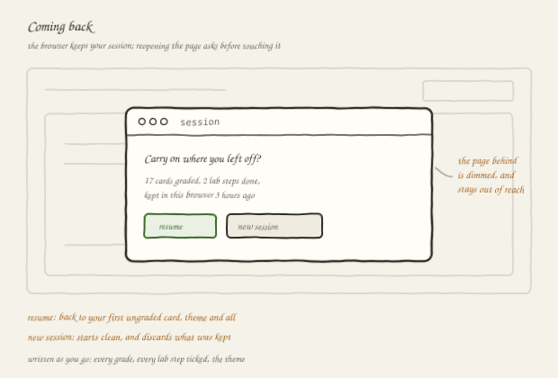
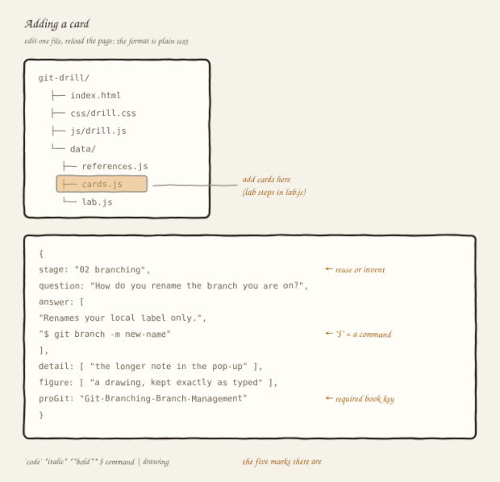

# git drill

A flashcard deck and a hands-on lab for learning git, in one page, served at
[adonnen.github.io/git-basics-drill](https://adonnen.github.io/git-basics-drill/).
You can also clone the repository and open the page from your disk: it holds
everything it needs, and it works offline and with no account.

- **A deck of flashcards**, grouped into stages that run from your first `init`
  to cutting a release
- **A multi-step lab** you run in a terminal, against a real repository
- Every card links into the matching section of *Pro Git*, and into Wiegley's
  *Git from the Bottom Up* where that book goes deeper. A few cards cover
  features newer than both books and also link into git's manual

---

## Start in thirty seconds

Open [adonnen.github.io/git-basics-drill](https://adonnen.github.io/git-basics-drill/).
There is nothing to install and no account to create. The page keeps your
session in the browser and writes a file to your machine only when you save
your progress.

Clone it when you want the deck offline, or when you are ready for the lab,
whose steps you run in a terminal against a repository on your machine:

```bash
git clone https://github.com/adonnen/git-basics-drill.git
cd git-basics-drill
```

Then open `index.html` by double-clicking it or dragging it into a browser
window.

You can also use **Code → Download ZIP** on GitHub and unzip it. Either way you
need the whole folder: `index.html` loads the stylesheet and the data files from
the directories beside it, so that one file on its own shows a blank page.

The page is static, so any host will serve it as it stands. The URL above is
this repository published through GitHub Pages by
[`.github/workflows/static.yml`](.github/workflows/static.yml). The workflow
runs [`tools/check.js`](tools/check.js) first, so a deck that fails the checks
never deploys. It then stamps the release tag into `data/version.js`, and the
hosted page shows that version. A fork can do the same under
*Settings → Pages → Source: GitHub Actions*.

The page works in Chrome, Edge and Firefox, and in Safari with the storage
limits described under [Saving progress](#saving-progress).

---

## The two views

A switch in the top right moves between them.

### Cards



Read the question, answer it in your head, then flip the card and grade
yourself honestly. Cards you mark **again** come back for a second pass at the
end; cards you mark **got it** do not. A card the lab practises says so at the
foot of its answer, naming the act and the step; click the note to go there.

Two filters sit above the card. The **keyword box** keeps any card containing
at least one of your terms, so `rebase stash` shows cards about either, which
helps when you know the word but not the stage.
The **stage chips** narrow the deck to one stage, so you can drill just merging,
or just the undo family. Use both to search within a stage; the count beside the
box tells you how many cards are left. Both also work with the [level
switch](#levels), and a stage with no cards at the current level says so.

The row of dots at the bottom has one dot per card: green for solid, rust for
revisit, and an amber ring for where you are. It follows the filters, so it
always shows the set you are working through. Click any dot to jump there.

**Keyboard**

| key | does |
|---|---|
| `space` | flip the card |
| `←` `→` | previous / next |
| `g` | grade "got it" |
| `a` | grade "again" |
| `d` | open the details pop-up |
| `/` | jump to the keyword box (`esc` clears it) |
| `s` | shuffle the deck |
| `l` | cycle the level: basics, intermediate, all |
| `t` | cycle the theme |
| `⌘/ctrl-s` | save progress |

### The details pop-up



Once a card is flipped, a **details** button appears. It opens a paragraph with
the caveats and reasons behind the answer, and on many cards the paragraph
also shows the commit graph after each command. Below it come an ASCII figure
and a link to the matching section of *Pro Git*, plus links to *Git from the
Bottom Up* or git's manual where the card cites them.

### Lab



The lab is a multi-step exercise you run in a real terminal, against a directory
on your machine. Each step states a requirement and leaves the command to
you, so you have to know the tool to get there. The solution sits underneath,
blurred and unselectable, until you press **show solution** or click the
blurred block itself.

Acts I–IX build a single repository from nothing. Act VIII keeps a long-lived
`release` branch beside `main`, one branching model among several, and works
through getting a single fix into it: copying the fix with `cherry-pick -x`,
watching the next merge of `main` into `release` bring the original into a
branch that already holds its copy, and merging one fix into both branches as
the same commit. Three acts are marked **optional**: VI puts a file into the
repository's root commit, IX looks at the refs behind the branch names and at
commits that sit on no branch, and X adds a remote. Skipping them leaves the
acts after them working. Act X has you create a bare repository next door to
act as the "server", so you practise `push`, `pull`, tracking branches,
`--force-with-lease`, pruning and tagging a release locally, with no account
anywhere.

The steps grow a small Python module, but the code is only a prop, and your own
files work too. Wherever the git lesson needs an edit of a particular shape, such
as two changes far apart in one file or a line both branches will fight over,
the task names that condition explicitly and the solution explains the reasons behind it.

The round button at the right end of an act's divider folds the act away and
opens it again. The count beside the button shows ticked steps over the act's
total, and you can still read it while the act is folded. An act whose steps
are all ticked comes back folded when you resume a session after a reload or
load a progress file. Ticking the last box yourself leaves the act open, since
you are still working in it.

Everything the lab creates lives in two or three directories; the last step of
act VII says how to delete them, and the last step of act X does it.

You need git and a shell: Terminal on macOS or Linux, **Git Bash** on Windows.

---

## Levels



The full deck suits someone coming back to git and is too big for someone
starting. The third switch in the top right cuts the deck and the lab down to a
first pass: **basics** is 49 cards and 31 steps, **intermediate** adds the rest
of the everyday material, and **all** is everything. The switch sits with the
view and theme switches because it governs the lab too, and the card filters
are hidden in the lab view.

The levels nest, so choosing intermediate shows the basics cards as well. That
way each level works on its own: an intermediate card that leans on a basics
idea would be no use with the basics card hidden. Under that rule an *advanced*
position would select the same cards as *all*, so the switch has three
positions.

Basics is the minimum you need to work with git: making a repository, staging,
committing, reading status, branching, merging, rebasing, pushing and pulling
against a remote, and resolving one real conflict by hand.

The lab is harder to cut down than the deck, because its steps run in order
against a single repository: the steps a level keeps must still work as a
sequence, each one finding the state it expects. So basics keeps some steps
only for the state they set up. *Add the first real source file* is one: it
writes the two lines act IV later puts in conflict, far enough apart that git
reports two separate conflicts. Acts VI to IX keep nothing at basics and are
not drawn at all, and the numerals keep their gaps (I, II, III, IV, V, X), so
you can see that some acts are hidden.

The level is remembered with the rest of your session and travels in progress
files. A file saved at one level opens at another with everything kept: ticks
and grades for hidden material stay in the file and reappear when you widen the
switch.

---

## Saving progress



Your browser keeps the session as you go. Grade a card, tick a lab step, or
change the theme or the level, and the browser stores it straight away, so you
can close the tab at any time. When you open the page again, it asks what to do
with the stored session:



- **resume**: takes the session back and puts you at your first ungraded card
- **new session**: starts clean and discards the stored session

Until you choose, everything behind that panel is dimmed and out of reach. The
panel says how much it is holding, so you know what a new session would
discard. `enter` resumes.

The browser store covers one browser on one machine. To move progress between
machines, or to keep a backup, save it to a JSON file, for example on a USB
stick or next to your notes. One file holds every card you graded, every
lab step you ticked, and your theme and level.

- **save progress**: writes to the file you last chose, or asks for one
- **save as…**: picks a different file and leaves the bound one alone
- **load progress…**: reads a file back and makes it the live session

In Chrome and Edge, saving overwrites the same file every time. Firefox and
Safari download a new copy each time, to wherever the browser saves downloads,
because they do not yet support the File System Access API that the overwrite
uses. The content is the same either way.

Both stores identify a card by its *stage* and *question*, and a lab step by its
*title*, so progress keeps working when answers are polished or the deck is
reordered. Renaming a stage or moving a card to another stage loses its grade,
like rewording its question. Anything that no longer matches is reported as
unmatched. A file that matches nothing at all, such as one saved before its
questions were reworded, is refused, so it cannot wipe what you have on screen.

Safari refuses browser storage to pages opened from disk, so there the session
lasts as long as the tab, and the file is the only store. On the hosted page
Safari keeps a session like any other browser, though it clears a site's storage
after about a week without a visit. A progress file survives that. Chrome puts
every local file under one origin, so two copies of this page on the same
machine share one session.

## Themes

The theme has three settings: **auto**, **light** and **dark**. Auto follows
your operating system, so a machine that switches at sunset switches the page
with it. Press `t` to cycle. The choice is kept with the session and travels in
your progress file, so the page opens in the theme you left it in.

---

## Example aliases and settings

[`examples/gitconfig`](examples/gitconfig) collects the aliases and settings the
cards refer to, ready to paste. Open your own config with
`git config --global --edit` and take whichever parts you want. Every line has
a comment saying what it does and why.

When a card mentions one of these shorthands, such as `git lg`, `git s` or
`git nuke`, the name is a green chip. Click it and a pop-up shows what it
expands to, what it is for, and the one command that installs it. Every
card also makes sense without them.

Start with these on day one:

```ini
[alias]
    lg  = log --all --oneline --graph --decorate   # the graph, every branch
    lgb = log --oneline --graph --decorate         # ...this branch only
    s   = status -sb                               # status without the tutorial
    staged = diff --cached                         # what you are about to commit
    fixit  = commit --amend --no-edit              # fold a forgotten file in

[pull]
    rebase = true          # replay your commits on top, no merge commit
[merge]
    conflictStyle = zdiff3 # show the ancestor inside a conflict (git 2.35+)
[rerere]
    enabled = true         # reuse a conflict fix you made before
[fetch]
    prune = true           # forget remote branches that no longer exist
[push]
    autoSetupRemote = true # a new branch pushes without needing -u (git 2.37+)
```

Of these, `rerere` and `push.autoSetupRemote` save the most work, and both are
safe to turn on everywhere.

The file also has a guarded `nuke` alias that asks before discarding
uncommitted work, and a commented submodule block to uncomment if you need it.

## Contributing

Cards and lab steps live in `data/`, so you can add them without touching the
engine in `js/`.

```
git-basics-drill/
├── index.html          the page, markup only
├── css/drill.css       every style, in ten commented sections
├── js/drill.js         the engine; you should not need to edit it
├── data/
│   ├── references.js   the sources' sections and the aliases cards link to
│   ├── cards.js        the flashcards        ← add cards here
│   ├── lab.js          the lab steps         ← add steps here
│   │                   these three are plain lists of text, see below
│   └── version.js      "dev" in the repo; the deploy stamps the release tag
├── examples/gitconfig  the aliases and settings the cards refer to
├── tools/check.js      verifies a change without opening a browser
├── docs/               the sketches in this README
└── .github/            the Pages workflow: check first, then stamp and deploy
```

### Adding a card



Open [`data/cards.js`](data/cards.js), find the stage you want, and copy an
existing card. A card is a block of plain text, so you do not need to know HTML
or JavaScript:

```js
{
  stage:    "02 branching",
  level:    "intermediate",
  question: "How do you rename the branch you are on?",
  answer: [
    "Renames your local label only.",
    "$ git branch -m new-name",
    "| before:  old-name",
    "| after :  new-name"
  ],
  detail: [
    "A branch already pushed needs the remote told separately: delete the old",
    "name there and push the new one."
  ],
  figure: [
    "before:  old-name",
    "after :  new-name"
  ],
  proGit:   "Git-Branching-Branch-Management",
  bottomUp: "the-beauty-of-commits"
},
```

`level` is optional and takes `"basics"` or `"intermediate"`; see
[Levels](#levels). An untagged card appears only in the full deck, so leaving
`level` off is a decision too. That errs on the safe side: if someone forgets to
classify a card, it stays out of a beginner's first pass. A card belongs in
basics only when someone in their first month would meet it *and* every idea it
leans on is basics too. People most often miss the second condition.

Every line goes in `"double quotes"`, separated by commas. Five marks work in
`question`, `answer`, `detail` and lab tasks:

| you write | you get |
|---|---|
| `` `git status` `` | code, in the accent colour |
| `*text*` | *italic* |
| `**text**` | **bold** |
| `$ git status` | a terminal block |
| `\| A ── B ── C` | a small drawing, shown exactly as typed |

Several `$` lines in a row become one block, and so do several `|` lines, so a
two-command answer is two lines and a four-line diagram is four. Everything else
is plain text: write `<` and `&` normally and ignore HTML entirely.

A `|` drawing appears where it is written. In `answer` it shows on the card
itself; in `detail` it shows inside the pop-up's paragraph, between the
sentences it illustrates. The separate `figure` field sits below the paragraph,
above the links. Use a drawing in the answer for a quick sketch, one in the
detail to show a history step by step, and the figure for the fuller version.

Write `` `git lg` ``, or any other name from the alias table at the foot of
[`data/references.js`](data/references.js), and it becomes the green chip that
opens what that alias expands to. Names outside that table, `git status` among
them, stay ordinary code. To make a new alias clickable, add it there with its
definition copied from [`examples/gitconfig`](examples/gitconfig);
[`tools/check.js`](tools/check.js) compares the two and fails if they ever
disagree.

Reuse an existing `stage` to add to that stage. Write a new one and a new stage
appears by itself, with its own filter chip and its own gap in the row of dots.
There is nothing to register.

`proGit` is required, and `bottomUp` and `manual` are optional; all three are
keys into `data/references.js`. `manual` is for features newer than both books,
and its key names a page of git's documentation on git-scm.com plus the
anchor of the option. If the section you want is not in `data/references.js`,
add it there first.

`lab` is optional too: the title of the lab step that practises the card,
copied exactly from [`data/lab.js`](data/lab.js). The answer side then ends in a
small footnote naming the act and the step, and clicking it opens the lab at
that step. The console reports a title that matches no step, and a step above
the card's level, since a reader at that level would be sent to a step the
switch hides.

Reload the page when you are done. **Open the browser console** (F12): every
load checks the data and reports problems in plain language, naming the file and
the card:

```
git drill found 2 problem(s) in the data files:
  cards.js, card 47 (05 conflicts): "detail" should be a list of lines in [ ]
  cards.js, card 47 (05 conflicts): "Git-Basics-Typo" is not in references.js
```

A blank page almost always means a missing comma or quote; the console names the
line.

### Adding a lab step

A lab step is the same kind of block, in [`data/lab.js`](data/lab.js):

```js
{
  title: "Delete the merged branch",
  level: "basics",
  task: [
    "Remove the branch label using the form that refuses to delete unmerged",
    "work. Confirm the commits survived it."
  ],
  solution: [
    "git branch -d feature/queue",
    "git branch              # only main remains"
  ]
},
```

Write each task as a requirement, so the reader has to know the tool to find
the command. `solution` lines are shown exactly as typed, so comments and
indentation line up.

`level` works as it does on a card, with one extra obligation. The lab's steps
run in order against one repository, so before you move a step down a level,
check what its solution *produces* as well as what it teaches. A level's steps
have to remain a sequence that works: every step finds the state it expects,
and none of them destroys state a later one needs. `node tools/check.js` will
tell you if an act has been emptied, but it cannot tell you that step 14 now
expects a branch step 9 used to make.

Act dividers are entries with an `act` field and no task, and `optional: true`
gives the act its OPTIONAL badge:

```js
{ act: "IV — divergence and a real conflict" },
{ act: "X — optional: working with a remote", optional: true },
```

Steps are numbered automatically, so inserting one renumbers the rest. An act's
fold count is the number of steps between its divider and the next, so moving a
step across a divider updates both counts. A reader's ticked steps are
remembered by the step *title*, so you can reorder steps freely, but
**renaming** one loses its tick in progress files people have already saved.

### Checking a change

```bash
node tools/check.js
```

It needs only node. It boots the engine against a stand-in for the browser and
checks the data files, the five text marks, the alias chips against
`examples/gitconfig`, both filters, view switching, the save/load round trip
and the session the browser keeps. It exits with code 1 if anything fails.

The deploy workflow runs the same script before publishing, so a change that
fails it never reaches the hosted page. Running it locally gives you the answer
sooner.

To check anything visual, such as layout, themes or the blur on lab solutions,
open the page.

### House style for cards

Keep these consistent, since a deck that reads in two voices is harder to
drill:

- Ask one thing per card. If the answer needs "and", it is two cards.
- Build on what came before. A card may use only terms that an earlier card at
  its own level has explained, or that it explains itself where the term first
  appears. The same holds for the lab, whose steps are read in order too.
- Phrase questions as tasks, or as failures met in practice: "you rebased and
  push is rejected, why" is better than "what does `--force-with-lease` do".
- The answer is the short version; the pop-up holds the details.
- A figure should show a shape: a graph, a before-and-after, a table of what
  each flag touches. A figure that only repeats the answer is cut.
- Draw a history the way the details pop-ups do. `C` is a trunk commit, `F`
  yours, `T` a teammate's, and a prime marks a copy. `← name` sits on the
  commit a name points at, and `(HEAD)` on the branch HEAD is attached to. Draw
  one picture per command, `──┐ │ ┘` for a merge, and no line wider than 58
  columns, since that is what the pop-up shows without a scrollbar.

Write cards in your own words. Linking to a book creates no obligation, but
copying from it does. Pro Git
([progit/progit2](https://github.com/progit/progit2)) is CC BY-NC-SA 3.0, which
cannot be redistributed under this repository's MIT licence, so neither its
prose nor its diagrams may be adapted into a card. Git from the Bottom Up
([jwiegley/git-from-the-bottom-up](https://github.com/jwiegley/git-from-the-bottom-up))
is CC BY 4.0 and would allow it with credit, but every fork would then have to
carry that credit beside the MIT notice. It is simpler to describe what git does
and draw the figure yourself. git's manual is GPL-2.0 like the rest
of git ([git/git](https://github.com/git/git)), so the Pro Git rule holds there
too: quote what git prints and leave the manual's sentences where they are.
The licences are in those repositories if you want to check them yourself.

---

## Notes for the curious

The data files are scripts because browsers refuse to `fetch` a file from disk
but will load a script that sits beside the page, so a double-click on
`index.html` works. The contents are still plain lists of text.
The repository also has no build step: the committed files are the files the
browser runs. Edit a file, reload the page. The one exception is
[`data/version.js`](data/version.js): the repository commits a `dev`
placeholder, and the deploy workflow rewrites it with the output of
`git describe --tags`. That is how the hosted page can say *release v0.0.3*, or
*v0.0.3+* when there are commits after that tag, while a local copy says `dev`.
The release tag is the only version anyone maintains.

To serve the page instead of opening it from disk, any static server works:

```bash
python3 -m http.server 8000     # then open http://localhost:8000
```

`js/drill.js` is organised into twelve commented sections; the header block
lists them. The engine contains no card, stage or step of its own; they all
come from `data/`.

---

## Credits

The cards point at two books, both free to read online:

- **Pro Git**, Chacon & Straub: <https://git-scm.com/book/en/v2>
- **Git from the Bottom Up**, John Wiegley: <https://jwiegley.github.io/git-from-the-bottom-up/>

For features newer than both books, a few cards link to git's manual:
<https://git-scm.com/docs>.

Use the deck to find out what you have retained from the books, and the books to
learn it. The links are a bibliography: no text or figure from any of these
sources is reproduced here.

The commit graphs drawn step by step in the details pop-up use a style common in
git answers on Stack Overflow: the graph is redrawn after every command, with
each branch name next to the commit it points at. [This answer on
rebase](https://stackoverflow.com/questions/44795166/git-rebase-strange-behavior)
is a good example. Many Stack Overflow contributors have explained git this way
for years, and their answers inspired the drawings in this deck. A hat tip to
all of them. The histories drawn here are the deck's own.

The author built this repository to learn the git basics it drills, and
vibe-coded it with Claude, as the commit trailers show. Every output a lab step
quotes was reproduced against a real git before it was committed. The outputs
quoted on cards were checked by hand, which is less reliable, so please report
any that look wrong.

---

## License

MIT, see [LICENSE](LICENSE). You can use and adapt it for any purpose,
commercial included, as long as every copy keeps the copyright notice and the
licence text.
